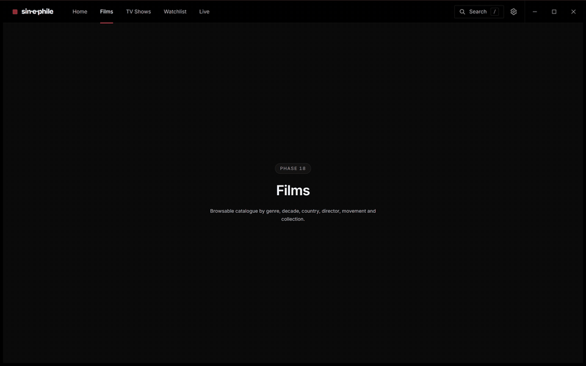

# sin-e-phile

**A Windows desktop media engine that unifies streaming, torrenting and your own
local film library behind one semantic search engine and a discovery-first
recommender.**

> **Status: Phases 0–10 of 28 closed — Tier A complete, Tier B under way.** The
> catalogue is real: 2.7 million titles ingested offline from public datasets, with no
> API key of any kind, searchable by title, person, filter and meaning. And now it plays:
> search, open a film, press Play, and it streams — from the Internet Archive's
> public-domain films, a torrent, or a file you drop on the window — in an embedded
> player with hardware decoding, drivable end to end with an Xbox controller. Every copy
> a source offers is now scored and ranked — fakes caught, your language and quality
> honoured, a broken copy replaced by the next without a word. Subtitles find themselves
> and line themselves up with the film's speech.
> This README describes what is being built and is updated at
> the end of every phase that changes what the app can do. It is never allowed to
> over-claim; the [feature list](#what-actually-works-today) below says exactly what
> exists.
>
> Follow along in [`PROGRESS.md`](PROGRESS.md).

*Recorded from the real window: search, the detail page asking its sources, Play, and
the film resuming where it was left — 5.5 s from Play to picture over the network.*

---

## What this is

It is a media **engine**, not a media service. It ships with **no catalogue of its
own and no content sources** — see [the legal posture](#the-legal-posture), which is
architectural rather than a disclaimer.

What it ships is the machinery: a semantic search engine, a taste model that learns
and deliberately pushes back against itself, a torrent engine that streams rather
than downloads, a player meant to rival commercial ones, and a local-library matcher
that identifies your files by looking at them rather than trusting their names.

The core loop: **search or browse → pick something → the app decides how to get it →
it plays, in seconds, at the best quality available, in the language you want, with
subtitles already in sync.** The user never sees a torrent, never sees a file list,
never sees a resolution debate. They see a play button.

---

## What makes it interesting

Four problems here are genuinely hard, and they are the reason this project exists
rather than being a wrapper around someone else's player.

### Hybrid semantic search that never gets an exact title wrong

*"Slow films about loneliness."* *"Like Wong Kar-wai but Korean."* Both should
work — and typing `Heat` must still put **Heat** first, every time.

Those two requirements pull in opposite directions. Semantic search on embeddings is
good at mood and terrible at exactness; BM25 keyword search is the reverse. The
approach is a quantised sentence-transformer running locally through ONNX Runtime,
an HNSW index for approximate nearest-neighbour lookup, SQLite FTS5 for BM25, and
**reciprocal rank fusion** to combine them — with an exact-title short-circuit that
guarantees a literal match always ranks first.

All of it offline, on a weak machine, inside an **80 ms p95 keystroke-to-results
budget that includes embedding the query**. Measured by an eval harness against a
hand-graded corpus: nDCG@10 > 0.75, exact-title top-1 = 100%.

### A torrent scheduler built for playback, not for completion

BitTorrent is designed to download files *out of order* — rarest-first is what keeps
a swarm healthy. Video playback needs bytes *in order*, right now, just ahead of the
playhead. Those two facts are in direct conflict, and resolving it is the hardest
engineering in the project.

The scheduler is deadline-driven: a priority window that tracks the playhead, a
rarest-first background fetch for everything else, and re-prioritisation within 2 s
when the user seeks into an unbuffered region. The in-progress torrent is exposed
over a local HTTP server with correct range support, so the player can treat a
live swarm as an ordinary file.

Target: **playback begins in under 8 seconds** on a healthy swarm, and the buffer
ahead of the playhead never starves under a documented bandwidth floor.

### Subtitles that are in sync on the first frame, always

Not "with a nudge button". In sync, with no user action.

Most tools offer you an offset slider. That fails on the common case, because a
subtitle file authored for a 25 fps broadcast master drifts *progressively* against
a 23.976 fps release — an error that grows over the runtime and that no constant
offset can fix. You need offset **and** framerate scale: an addition and a
multiplication.

The aligner extracts a voice-activity signal from the audio via FFmpeg, builds a
comparable signal from the subtitle timings, and solves for both by
cross-correlation. It scores its own confidence and **refuses to apply a
low-confidence alignment**, because making things worse is worse than doing nothing.

Target: **>90% of a deliberately-corrupted fixture corpus aligned within 150 ms.**

### A recommender that is allowed to surprise you

An app with everything is worthless without a reason to choose. So discovery is not
a feature bolted on at the end — it is the point.

Three layers: content-based similarity against **multiple** taste vectors (a person
who loves both Tarkovsky and slasher films is not described by their midpoint, so
their positive signals are clustered into 3–8 taste *modes*); item-item
collaborative filtering precomputed offline from MovieLens, giving real
"people who loved this also loved" signal with **no server and no other users**; and
a hybrid ranker with maximal marginal relevance so no rail is eight films by one
director.

On top sits a **contextual bandit** over recommendation *strategies* — safe-familiar,
adjacent-stretch, cross-mode bridge, blind-spot, canon-gap, deep-cut — learning from
what you actually finish. With a **minimum exploration floor**, so the model cannot
collapse into a filter bubble even if you always pick the safe option. A filter
bubble is an optimisation failure, not an inevitability.

Every recommendation carries a truthful, human-readable reason.

---

## Measured, not asserted

Two audits run in CI today, and four evaluation harnesses arrive with the phases
that need them. All of them track quality over time. **A quality
regression blocks a merge exactly as a failing test does** — including in an earlier
phase's metric, which is the kind of rot that otherwise goes unnoticed.

| Harness | Metric | Target |
|---|---|---|
| Filename identification | top-1 accuracy · false-confident rate | > 95% · **< 1%** |
| Subtitle alignment | within 150 ms | > 90% |
| Search relevance | nDCG@10 · exact-title top-1 | > 0.75 · **100%** (measured: meaning **0.047, not met**; filters 1.000; exact title **43/43**) |
| Recommender quality | Recall@20 vs popularity baseline · catalogue coverage | **+40% relative** · > 15% |

The false-confident rate matters more than the accuracy number. Being wrong while
confident is the worst failure mode a file matcher has, and it is measured
separately for that reason.

Running already, on every push:

| Audit | Checks | Current |
|---|---|---|
| `npm run audit:contrast` | every token pair against WCAG AA | 29 enforced pairs pass |
| `npm run audit:ui` | 60fps rail · focus rings · keyboard reach · reduced motion | worst frame 16.8ms, 0 dropped |

Both were verified to **fail** on a deliberately reintroduced regression before being
trusted. A check that has never been seen to fail is not evidence of anything, and
the UI audit found four bugs on the day it was written that no screenshot showed —
including virtualisation that had silently stopped working, and 487 of 500 cards
being unreachable by keyboard.

---

## The legal posture

**This application ships zero content sources.** No indexer URLs, no scrapers for
specific sites, no bundled addon list, no default source URL — not in the code, not
in config, not in test fixtures, not in documentation, and **not in git history**.

What ships instead is the *machinery*: a documented, versioned source-backend
protocol; a declarative, non-executable addon manifest format; a catalogue browser
that fetches a URL **the user supplies**; and working reference backends against
unambiguously legal sources only — the local filesystem, the Internet Archive's
public-domain collection, and user-supplied M3U or direct HTTP.

This is deliberately Stremio's architecture, and it is why Stremio still exists
while Popcorn Time's forks were removed from GitHub. It costs a user nothing — they
configure their own sources in thirty seconds — and it is the difference between a
repository that can be shown to an employer and one that gets taken down.

**And it is enforced by a machine, not by discipline.** `tools/guard/` runs on every
commit and every push, scanning the working tree *and every blob that has ever
existed in the history*. It uses plaintext structural patterns (magnet URIs, bare
infohashes, tracker announce paths), a salted-hash denylist so that forbidden names
never appear in plaintext even in the denylist itself, and an allowlist where adding
a single line requires an architecture decision record.

The guard is **verified**, not assumed: 30 self-test checks covering both the
vectors that must fire and the ones that must not, using RFC 2606 reserved domains
so it can be proven to work without a real forbidden string ever entering the
repository. See [`tools/guard/README.md`](tools/guard/README.md).

---

## No key required, no telemetry, no server

- **Works with no API key at all.** The offline catalogue (IMDb + MovieLens, both
  free, no account) supplies titles, cast, crew and ratings — and search, the taste
  model and the recommender all run on it unchanged. TMDB adds artwork and is
  strictly optional (ADR-0013).
- **No telemetry.** Nothing leaves your machine except requests to services *you*
  configured. No analytics, no crash reporting to a server. Crash logs are local.
- **No server component of any kind.** Not for accounts, not for recommendations,
  not for sync. The collaborative-filtering signal is precomputed offline and
  shipped as a static file.
- **Portable by default.** All data lives in `./data/` next to the executable. Move
  the folder to a USB stick and it keeps working.
- **Quality is never withheld.** If 4K exists and your machine and connection can
  handle it, you get 4K. Selecting quality is a preference, not a paywall.

---

## Performance budgets

Enforced against **Tier 0** — a deliberately weak machine: under 8 GB RAM, no
hardware video decode, two cores. Not "degraded but functional" on such a machine;
**excellent**.

| | Budget |
|---|---|
| Cold start to interactive | < 4 s (Tier 0) · < 2 s (Tier 2) |
| Search keystroke → results | < 80 ms p95, *including query embedding* |
| Play → first frame, local | < 500 ms |
| Play → first frame, healthy swarm | < 8 s |
| Idle RAM | < 250 MB (Tier 0) |
| Home screen scroll | 60 fps sustained |
| Installed size | < 120 MB, excluding optional models |

Features degrade by hardware tier through a single module, and **every gated feature
degrades to something good, never to something broken or empty**. Face recognition
off means the pause overlay shows the full cast list, beautifully.

---

## What actually works today

**Phases 0–14 — the shell, the design system, the catalogue, search, sources, torrents,
the player, choosing a source, subtitles, the player experience, the local library,
downloads, and profiles.**
Honestly:

- ✅ Posture guard, secret scanner, and prerequisite doctor — all three verified by
  deliberately planted failures
- ✅ CI on `windows-latest`; git hooks; GPL-3.0; specification at 3.2.0 with 43 ADRs recorded
- ✅ Machine-readable project state for all 28 phases, generated from the spec and
  schema-validated so a criterion cannot be marked done without evidence
- ✅ A Tauri window that opens, with a top masthead for navigation and hardware tier detection.
  Cold start measured to the first painted frame — 515ms and 660ms across two
  release runs — not to the point where the window handle exists, which would
  have been a flattering and dishonest 267ms
- ✅ All three Phase 1 spikes de-risked: libmpv drives from Rust, librqbit streams,
  and the ONNX embedding model runs locally. The compositing problem that would
  have surfaced in Phase 8 was found and solved in Phase 1
- ✅ A design system built from a chosen mockup: tokens, 21 components, a
  virtualised rail that holds 60fps with 500 cards and is keyboard-complete, and
  two audits in CI that enforce all of it
- ✅ The database everything else sits on: 19 tables across four reversible
  migrations, generic over media kind so reading and comics need no migration later.
  Indexed lookup over 500,000 rows measured at 0.179 ms p99 against a 100 ms budget —
  and the benchmark caught an index that was silently full-scanning at 26.7 ms
  while still passing the criterion
- ✅ A real catalogue, built offline with no key: 2,702,737 titles, 10 million credits,
  episodes for 4,529 series, and 61,912 films matched to MovieLens ratings. Ingestion
  survives being killed mid-run and resumes without repeating a row. The database is
  3.946 GB, 54 MB under its 4 GB budget after compaction.
- ✅ Hybrid search: an exact title is always first (**43/43** on a deliberately awkward
  fixture), keyword and meaning are fused by reciprocal rank, and "films directed by
  Alfred Hitchcock from the 1950s" is parsed into filters (**nDCG 1.000**). p95 is
  15.2 ms on the dev machine, including embedding the query locally.
- ❌ **Searching by meaning is not good enough.** nDCG@10 is **0.047** against a 0.75
  target, after five attempts; the last one, a full re-embed, made it worse. The
  [case study](docs/case-study/search.md) shows the failures with screenshots and
  explains them. This criterion is carried to Phase 16, not hidden.
- ✅ Sources: one interface that every source implements, a resolver that asks them all
  at once and never lets a slow one hold up the rest, and per-source health in plain
  words. Built in: the Internet Archive's public-domain films (a live query found
  *Night of the Living Dead*, and FFmpeg decoded the stream), your own links and M3U
  playlists, and a placeholder for local files.
- ✅ Addons, described by a declarative manifest and served by someone else: paste an
  address, read what it claims in sentences, confirm. Everything an addon sends is
  parsed as hostile — a corpus of 25 hostile manifests, 10,000 random mutations, and an
  addon that redirects, floods or stalls each fail alone. The
  [protocol](docs/specs/addon-protocol.md) is written for outside authors, with an
  example addon and a conformance test. **The app still ships no content sources.**
- ✅ A search the catalogue misses but a source can answer becomes a catalogue entry,
  marked as such, so an out-of-date catalogue is not a dead end.
- ✅ A torrent engine that streams rather than downloads: a seek into an unbuffered part
  of a 6 GB torrent is served in 0.2–3.7 s, the stream is byte-identical to the source,
  a dead swarm fails in seconds with a plain message, and seeding stops at completion by
  default. Bound to a VPN's adapter, its traffic cannot leak if the VPN drops — librqbit
  could not do that on Windows, so the project added it. On the same torrent it reached
  the first MiB in 3.6 s to qBittorrent's 13.1 s, with bulk speed level.
- ✅ Torrent playback starts fast: the torrent is started when a film's page opens, so by
  the time Play is pressed peers are already found. With five seconds on the page, Play to
  the first MiB took under 4 s in 9 of 10 live runs (most under 0.25 s); pressing Play
  instantly still waits on peer discovery, 4–55 s on this network.
- ✅ **It plays.** libmpv embedded in the window, with the app's own controls drawn over
  the video through holes cut in it, and a still frame under the pause screen. 4K HEVC
  HDR decodes on the GPU at half the CPU of software decoding; seeks land on the exact
  frame in under 5 ms; the position is saved and resumed across restarts; Play to picture
  is about 200 ms locally once the audio device answers, and 5.5–7.9 s streamed from the
  Internet Archive.
- ✅ An Xbox controller is a remote: the D-pad moves focus to whatever is nearest, A
  presses, B goes back, the triggers seek, and an on-screen keyboard appears for search.
  The whole flow — search, open, play, pause, seek, leave — is driven by a simulated pad
  in CI.
- ✅ **The TV look**: a white focus ring that glides between items on a spring, tiles that
  grow and lift, 125% scale with a pad, button hints, quiet ticks and rumble — and none of
  the motion under Windows' reduce-motion setting. Checked frame by frame in CI.
- ✅ **Choosing the copy.** Every copy is scored on nine terms and ranked: a "4K" file too
  small to be 4K, a 60-minute file for a 140-minute film, a name that contradicts its
  listing or an `.exe` are ranked last; your own file comes first. Pick an audio language
  or a quality and it plays a copy that has it, or says none does. A copy that will not
  start is replaced by the next — 8.1 s from a dead first choice to the next copy's
  picture. Ctrl+Shift+S shows the whole arithmetic.
- ✅ **Subtitles in step.** The film's own track if it has one in your language (no
  network at all); else a file beside it; else OpenSubtitles with your own key and a
  daily budget it cannot overspend. Anything not embedded is aligned to the film's speech
  — offset, framerate drift (23.976↔25) and an intro added or cut — or left alone when the
  aligner is not sure. 80/80 damaged files fixed to within 150 ms on the corpus, 0
  accepted against the wrong film; in the app a file 82 s late was fixed to within 67 ms,
  0.6 s after the first frame. G and H nudge them, and the film remembers.
  `crates/subtitle-align` is its own MIT/Apache crate.
- ✅ **The player as a place to stay.** Series pages with seasons, episodes and "airs
  Thursday". Pause and a panel shows the cast (a name opens their films), crew, ratings and
  more like this, painted in under 25 ms. The next episode is offered with a countdown; a
  film's credits play out before an end card. Scrub thumbnails, made with 0 dropped frames;
  picture-in-picture; a mini player while you browse; sound timing; statistics; `?` lists
  every shortcut. With a controller, every text field gets a TV keyboard with suggestions.
  Checked on all three hardware tiers, locally and streamed.
- ✅ **Your own library.** Add a folder and every film and episode in it is identified
  from its name, its folders and its length against the 2.7-million-title catalogue: right
  first time 99%, and of what it accepts without asking, 0.39% wrong (the target is under 1%).
  What it is not sure of waits in a review queue where one answer settles a whole series and
  is remembered. 10,000 files scan in about 36 seconds; renaming or moving a file, with the
  app open or closed, keeps it as the same file. Search, click and play: a local film's first
  frame in 388 ms. `crates/filename-parser` is its own MIT/Apache crate, measured on 658
  hand-labelled names.
- ✅ **Stream or download, said in one sentence.** A film's page measures the swarm for
  three seconds and weighs it against the film's bitrate, the free disk and how fast this
  connection is at night: "It would pause to buffer if streamed (1.8 MB/s against the
  2.0 MB/s it needs), so download it first, about a minute." Right in 9 of 10 trials chosen
  after the model was last changed. Downloads queue with priorities, tonight, and limits
  that hold to within 2% when measured; they survive a restart, keep their pieces when
  moved, and file into the library already matched. Your own qBittorrent can do the
  downloading, as a transport only; if it is closed, the built-in engine carries on. A cleanup
  view lists what is kept, watched films first. Measuring this found that every speed the
  app had shown since Phase 7 was 8.4 times too low; fixed, with a test.
- ✅ **Profiles and a first run.** Everyone in the house has their own profile, history, watchlist
  and taste, with a PIN if they want one; switching takes about 11 ms. Kids profiles show only what
  is positively known to suit children. A three-step first run (each step skippable) asks who it is
  for and what they like: films to pick by name across a century, six statements that are not
  genres, their own words, or an import from Letterboxd, Trakt, IMDb or MyAnimeList, which placed
  98.8% of 600 films correctly and none wrongly. Home's first version is never empty, key or no key.
- ⬜ Everything else described above this section

---

## Tech stack

**Shell** Tauri v2 · **Backend** Rust · **Frontend** React 18 / TypeScript strict /
Vite / Tailwind · **State** Zustand + TanStack Query · **Torrent** librqbit,
in-process · **Player** libmpv, embedded, custom UI · **Database** SQLite via `sqlx`,
WAL, portable · **Text search** SQLite FTS5 (BM25) · **Vector search** HNSW,
persisted · **Embeddings** ONNX Runtime + quantised sentence-transformer ·
**Media** FFmpeg

No Electron, no bundled qBittorrent, no cloud LLM in the critical path, no server
component, no Docker.

---

## Build it

See [`docs/SETUP.md`](docs/SETUP.md). Short version: clone, then
`python tools/doctor/doctor.py`, which tells you exactly what is missing and wires
up the git hooks.

## Documentation

| | |
|---|---|
| [`SPEC.md`](SPEC.md) | The complete specification, and the constitution of this project |
| [`PROGRESS.md`](PROGRESS.md) | Where it is right now — generated from the state file |
| [`docs/HOW_IT_WORKS.md`](docs/HOW_IT_WORKS.md) | Plain-English explanation of the whole system |
| [`docs/adr/`](docs/adr/) | Why each decision was made, and what was rejected |
| [`docs/RISKS.md`](docs/RISKS.md) | Risk register, each with a pre-decided trigger |
| [`docs/learning/`](docs/learning/) | Per-phase explainers — a deliverable, not a nicety |
| [`tools/guard/README.md`](tools/guard/README.md) | How the legal posture is enforced |

---

## Licence

**GPL-3.0.** Required by libmpv and FFmpeg linkage, and the correct posture for this
project. **Source only — no compiled installers are published.**

Built as a portfolio project by a student learning Rust and React. The constraint
that the author must be able to explain every part of it in an interview is treated
as binding as any technical requirement: code that works but cannot be explained is
a failure condition, which is why `docs/learning/` exists and why each phase has a
hard understanding gate before it can be called done.
