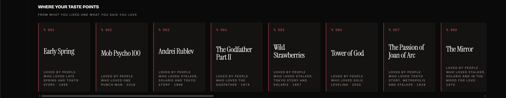

# Case study — the recommender

Phase 17, November 2026. Every number here is in `docs/eval-results.md` ("Phase 17") with the command that produced it.



## The problem

Home has one rail that is the app's opinion: "Where your taste points". It has to suggest what one person should
watch next, on their own machine, with no server, from a catalogue of 2.7 million titles (874,755 in the core tier),
and it has to say why. A suggestion without a reason is a guess the viewer cannot check; a reason that is not true is
worse. And it has to stay current: the author's rule is that nothing the app derives may be a snapshot that never
moves (ADR-0054).

## What was considered

- **Meaning alone** (Phase 15 already had it): a profile's taste as a few directions in the meaning index, and the
  titles nearest each. It knows what films are *about*. It does not know that people who love one Ozu film love the
  others, or that Tarkovsky's audience also loves *Come and See*, whatever the synopses say.
- **"People like you"** (user-user collaborative filtering): needs other people. There are none on this machine.
- **Learned models** (matrix factorisation and its descendants): accurate, but they need a training pipeline, and their
  reasons are latent factors nobody can read. A rail that cannot say why fails the brief.
- **A language model**: no cloud in the critical path (SPEC.md §5).
- **Item-item collaborative filtering from MovieLens**, chosen: 162,000 strangers' 25 million ratings stand in for the
  people this machine lacks. A title's neighbours are the same for everyone, so they are computed once, here, and
  stored (ADR-0019: the ratings are downloaded by the user, never shipped). And every neighbour has a reason built in:
  *the people who loved Stalker also loved this*.

## What was built

```
 each taste mode's nearest      neighbours of the 500        the newest work of whoever      the 100
 in the meaning index           best-loved titles            directed what was loved         most-voted
 (Layer 1)                      (MovieLens, AniList, TMDB)   (a title nobody has rated)
        \                              |                              |                       /
         `---------------------- about a thousand candidates ------------------------------'
                                            |
                one score per candidate: each part scaled 0..1 over the candidates, weighted
                                            |
             picked one at a time: the best score less how much it repeats the picks so far
             (maximal marginal relevance), within caps (two per director, two per franchise,
             five per year) and each taste mode within its share of the rail (calibration)
                                            |
               twenty picks, each with the reason that lifted it above a typical candidate
```

**The matrix** (`crates/recommend/src/cf.rs`). A like is four stars or more. Each person counts `1 / ln(e + likes)`, so
someone who likes everything says less about any one pair. Two titles' closeness is the people who liked both, `c`,
over `mass_i^(1-alpha) * mass_j^alpha`, where mass is how liked each title is. At `alpha` 0.5 that is cosine. Moving
`alpha` towards 1 divides the popular title's mass back out, so *The Shawshank Redemption* stops being everyone's
neighbour; too far, and the matrix recommends noise (at 0.9 it fell below plain popularity). The tuning users chose
0.65: three per cent of recall traded for reaching 16% of the catalogue instead of 10%. Built item by item with one
dense array per thread, it takes about ten seconds for 25 million ratings and keeps the best 50 per title.

**The score** (`crates/recommend/src/rank.rs`). Each part is scaled over the candidates, then weighted: closeness to the
nearest taste mode (1.0), the summed neighbour scores of the loved titles pointing here (0.5), how many loved titles
share a maker with it (0.1), the profile's taste axes (0.2), a little for what is already in the library (0.1).
Popularity weighs nothing: the most-voted still enter as candidates, but pushing them cost no recall to remove and
widened coverage.

**The reason** is the part that lifts a title furthest above a typical candidate: each part minus its median over the
candidates, weighted as in the score. A score only matters against the others, so that is the part that ranked it.

## How it was judged

MovieLens users are split by a hash of their id: 80% build the matrix, 10% tune, 10% judge, the same on every run. A
fifth of each judged user's likes is hidden; the rest becomes a profile, built exactly as the app builds one; the
recommender has twenty slots to find the hidden ones. **Recall@20** is the share it finds (out of at most twenty),
against the same twenty slots filled with the most popular titles. **Coverage** is the share of the matrix's titles
that reach at least one person's twenty. **Intra-list diversity** is how unlike each other a rail's titles are.
**Miscalibration** (Steck, 2018) is how far a rail's mix of taste modes is from the profile's. Every setting was chosen
on tuning users, by a rule written down before its run; the test users were scored at the end.

| On 15,640 test users | Recall@20 | against popularity | coverage | diversity | miscalibration |
|---|---|---|---|---|---|
| popularity | 0.1641 | | | | |
| the matrix alone | 0.2855 | +74.1% | 16.4% | | |
| the whole recommender, first build | 0.2834 | +72.7% | 16.6% | 0.407 | |
| calibrated | 0.2648 | +61.4% | 43.5% | 0.417 | 0.008 |
| **calibrated, with makers (the app's)** | **0.2639** | **+60.9%** | **45.7%** | **0.418** | **0.008** |

The targets were more than 40% above popularity (E1), more than 15% coverage (E2), no rail dominated by one director,
franchise or year and variety at least that of plain score order (E3), and a true reason for every pick (E4). All four
are met. Ranking a thousand candidates takes about 2 ms (p95 7 ms under load) on the development machine; the 150 ms
target is for the slowest machine the app supports, and that run is still to be made (E5).

## What went wrong, and what it taught

**The whole was worse than its part.** The first full recommender found fewer hidden favourites than the matrix alone
(+49% against +72%), whatever the weights. Comparing versions on the same tuning users found two choices of mine: only
the 60 strongest loved titles were asked for neighbours, and the caps were one per franchise and three per year. Asking
500 and loosening the caps to two, two and five recovered it. *Measure the structure before tuning the numbers.*

**The variety step was quadratic.** Re-comparing every candidate with every pick took 26 ms for a thousand candidates.
Keeping each candidate's closeness to its nearest pick, updated with only the newest pick, gives the same rail in 1 to
4 ms.

**The reasons were true and useless.** In the real window, all twenty cards said "Close to ...", Bresson's *Pickpocket*
"close to The Godfather and Oppenheimer". Closeness is high for every candidate the meaning pool brings, so as the
biggest part it named a mode for everything. The reason is now the part furthest above the median candidate, and the
same twenty say "Loved by people who loved Tokyo Story, Stalker and Solaris".

**A check that could not fail.** The cap check compared rails against the same caps they were ranked with, so it always
passed. It now judges the app's caps whatever the ranking used, and ranked with loose caps it catches 196 of 300 rails.

**The larger taste took everything.** A profile of seven films and two anime got twenty films: the loved part sums over
every loved title, so the larger taste wins title for title. Recall did not notice, because hidden likes follow the
larger taste too. Each taste mode now fills at most its share of the rail (largest remainder, every mode at least one).
The same profile gets fifteen films and five anime: Mob Psycho 100, "loved by people who loved One Punch Man". It cost
1.9 points of recall and nearly tripled coverage. That trade was taken knowingly: a rail that ignores part of a
person's taste is wrong in a way recall cannot see.

## Staying current

MovieLens' newest release ends in 2023 and the published meaning file at the catalogue it was made from, so the app
extends both itself, in the background after each launch's catalogue check:

- **Meaning for titles without it.** Run on a copy of the development catalogue, "the titles a refresh added" turned out
  to be 19,052 little-known titles of this year, while 1,331 titles with 10,000 votes or more (Doctor Who, One Punch
  Man, Solo Leveling) had no vector at all, because they had no synopsis when the file was made. The job now takes every
  core title without a vector, most-voted first, 2,000 a launch: a synopsis from TMDB (with a key), AniList (anime) or
  Wikipedia (the article's opening when its lead is a sentence), then a vector in a small graph beside the published
  one. Three launches on the copy gave 16, 170 and 188 titles meaning.
- **Live neighbours.** AniList's community recommendations and TMDB's stand beside MovieLens', asked once a week for
  what each profile loved. A live list has an order but no score, so its k-th row scores what MovieLens' k-th
  neighbour averages (0.29 at the first): neither source outweighs the other by the accident of its scale.
- **A title nobody has rated** reaches a rail the day it arrives, through its meaning and its makers: "By Andrei
  Tarkovsky, who made Stalker and Solaris". An end-to-end test adds a film through a fixture refresh and finds it in
  the rail, with a true reason, on the same launch (E7).
- **Rising now.** Each ratings refresh keeps a changed count's predecessor; the 200 biggest gains are Home's "Rising
  now".
- **Settings** says, per source, when it last updated and what it did.

Running the whole chain on a copy of real data, rather than on fixtures, found two traps the tests had passed. The
ratings refresh, rewritten to keep each vote count's predecessor, took 17 seconds per chunk of 200 instead of 8 ms: with
no statistics for one table, SQLite's planner scanned 3.3 million ids per chunk, so a refresh would have taken hours.
And titles given a synopsis after the meaning file was made would, at the next index rebuild, have been read as the
file's own and failed its verification. Both now have tests that reproduce the real conditions, and fail on the
broken code.

## What would be done differently

- **Judge calibration from the start.** Recall alone rewarded a rail that served the larger taste; the miscalibration
  measure should have been in the first harness, not found on a copy of real data.
- **Look at the real window earlier.** Two of the five fixes above came from looking at twenty real cards, not from a
  metric.
- **Franchises are guessed from titles** ("Toy Story 3" and "Toy Story"), because no free keyless source names them;
  a false match costs a title its place, never a wrong reason, but it is a proxy.
- **Without a TMDB key**, Wikipedia describes few of this year's titles (23 of the first 2,000 on the copy); the
  catalogue's newest titles get meaning mostly through AniList and the user's own key.
