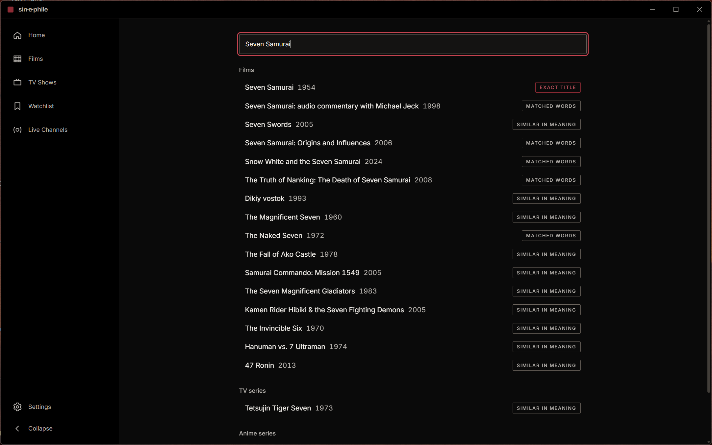
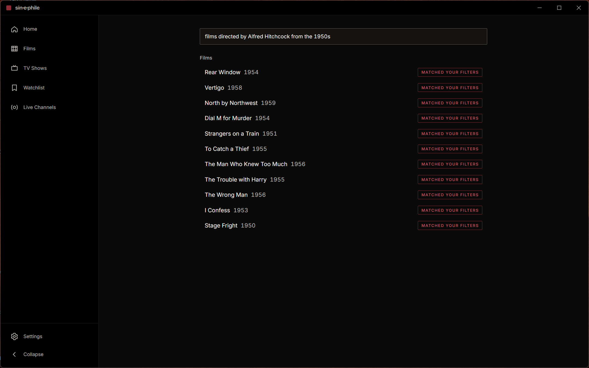
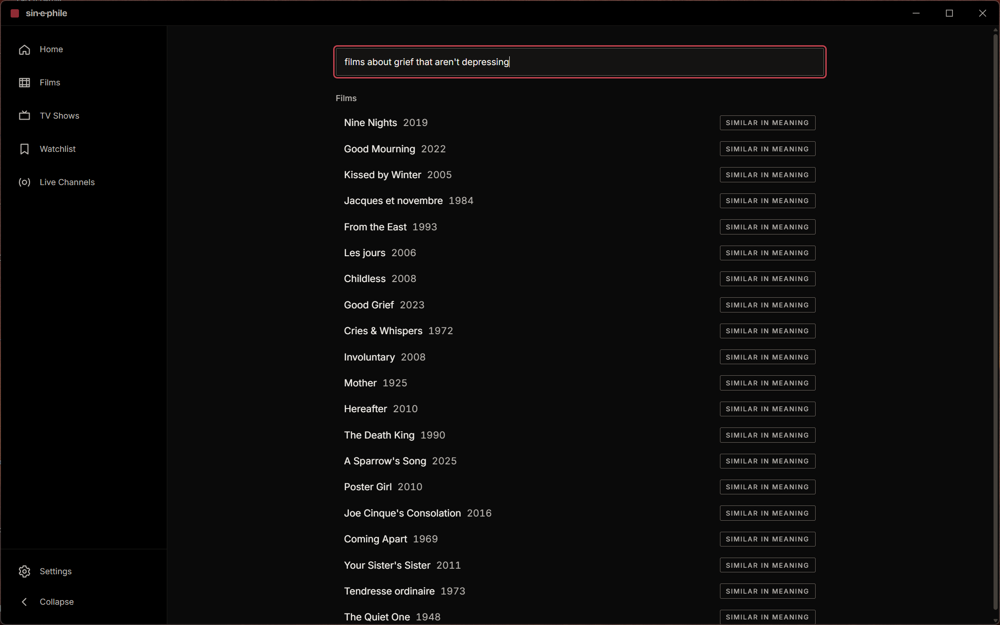
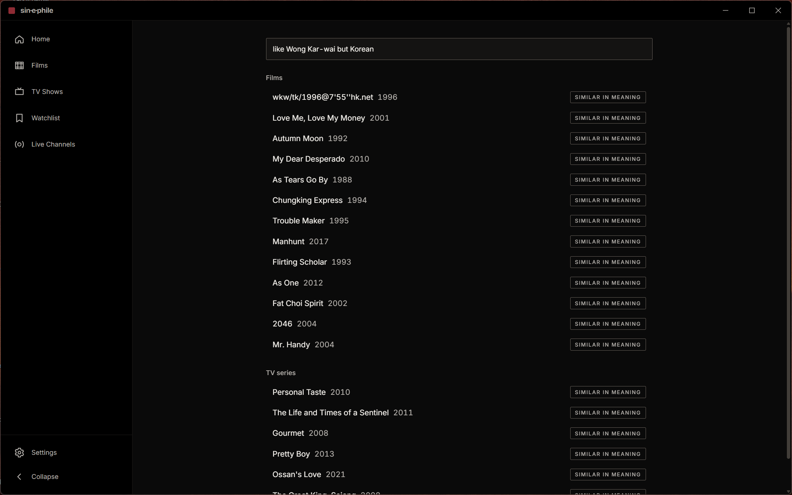

# Case study — search

**Phase 5.** Screenshots are of the release build on the real 2,702,737-title catalogue,
captured by `tools/shots/capture.ps1`, which launches the binary and types into it. They
are re-takeable: `powershell -ExecutionPolicy Bypass -File tools/shots/capture.ps1`.

---

## What the engine is

Three tiers, and the order is the guarantee.

1. **Exact title** — bypasses ranking entirely. Typing *Solaris* and not getting
   *Solaris* first is the failure a search engine is not allowed to have, and no amount
   of good ranking makes that *certain*. So it never enters the ranking at all.
2. **Fused** — BM25 and vector search combined by reciprocal rank, over positions rather
   than scores, because a BM25 score and a cosine distance are not comparable and
   pretending otherwise is a tuning problem with no stable answer.
3. **Fuzzy** — typo tolerance, only when the tiers above found almost nothing, because it
   costs a trigram scan over millions of rows.

Structured filters — year ranges, runtime bounds, "directed by" — are extracted before
any of that and applied as **constraints**, not fed to the embedder. Models are poor at
numbers; `release_year BETWEEN 1950 AND 1959` is not.

---

## It works, and here is what that looks like

**This one page shows every tier at once.** *Seven Samurai* (1954) is first and labelled
**exact title** — that is tier 1 refusing to let ranking have an opinion. Behind it, the
audio commentary and the *Origins and Influences* documentary arrive on **matched words**.
And then the interesting part, on **similar in meaning**: *The Magnificent Seven*, the
1960 Western remake of the film that was typed, and *The Fall of Ako Castle* and
*47 Ronin*, both tellings of the forty-seven rōnin. *The Magnificent Seven* shares one
word with the query; the other two share none.

Nothing in the ranking was told those films are related. The vector half put them there.
It also put *Kamen Rider Hibiki & the Seven Fighting Demons* and *Hanuman vs. 7 Ultraman*
there, which is the vector half being literal about the number seven.

**"films directed by Alfred Hitchcock from the 1950s"** returns eleven films, every one
directed by Hitchcock, every one released between 1950 and 1959, most-voted first. The
query is parsed into a director and a decade, the residual text is discarded as
meaningless, and the result comes from an indexed join rather than from hoping an
embedding encoded a date.

Measured: nDCG@10 of **1.0000** on the filter half of the fixture.

---

## And here is what does not work

**This is the query exit criterion E4 names, and it is not answered.** These are the
v3 documents (plot first, see below). The page is now about grief rather than titled
with it: *Nine Nights* is a Jamaican mourning wake, *Good Mourning* a comedy, *Hereafter*
and *A Sparrow's Song* about loss. *Good Grief* (2023), the comedy about bereavement and
the graded answer, has fallen from #1 to #8. *Cries & Whispers* at #9 is about as
depressing as cinema gets, and the clause "that aren't depressing" still has no effect
whatsoever. Negation is not represented.

**E4's second query, and a more interesting failure.** The engine clearly knows who Wong
Kar-wai is: *wkw/tk/1996*, *As Tears Go By*, *Chungking Express* and *2046* are his, found
from his name alone with no credit lookup involved. Around them sits Hong Kong cinema of
the same era: *Autumn Moon*, *Love Me, Love My Money*, *Flirting Scholar*. The TV series
section below is Korean drama.

So it understood **both halves of the query, separately, and composed neither.** It did
not find Korean films that resemble his; it found his films, his city, and some Korean
series.

Measured: nDCG@10 of **0.0472** on the meaning half, down from 0.1188 under the previous
document layout. Why it fell is the subject of the next section.

---

## Why, precisely

Not for want of trying, and the diagnosis is measured rather than assumed. Four distinct
attempts, each of which helped and none of which was enough (and a fifth, below, which
did not help):

| attempt | result |
|---|---|
| Load 233,114 Wikipedia synopses into a catalogue that had **zero** | helped, insufficient |
| Index only items that have descriptive text (855,703 → 119,874) | index 435 MB → 61 MB; helped, insufficient |
| Remove titles from the embedded document | helped, insufficient |
| Replace `all-MiniLM-L6-v2` with `bge-small-en-v1.5` | the Wong Kar-wai result above; insufficient |

The measurement that ended the sequence, before the model swap:

| item | cosine to a plot query describing it |
|---|---|
| *Manchester by the Sea* — its synopsis contains the query almost verbatim | **0.1944** |
| *Fish Hooky* — synopsis: "the 120th Our Gang short to be released" | **0.4194** |

Production trivia outscored a near-verbatim plot match by more than two to one. That is
**hubness**: short generic documents sit near the centre of an embedding space and are
therefore close to every query, and no amount of additional text fixes a document that
has none. `all-MiniLM-L6-v2` was also the wrong *kind* of model — trained for symmetric
similarity, asked to do asymmetric retrieval.

Swapping to a retrieval-trained model moved that pair from 0.1944/0.4194 to
**0.4947/0.4694** — the correct answer overtook the trivia. It did not reach E3's bar.

### A fifth attempt, which made the number worse

The v2 document led with the title. A probe over each query's six or seven contested
items showed that putting the plot first **reordered** them in favour of the graded
answers: under the grief query, the three graded films moved from #1, #6 and #7 to #1, #2
and #5. That was the trigger set for spending a three-hour re-embed of 858,170 documents,
so it was spent.

Over the whole catalogue it went the other way:

| query | v2 (title first) | v3 (plot first) |
|---|---|---|
| films about grief that aren't depressing | 0.4770 | **0.1505** |
| like Wong Kar-wai but Korean | 0.2385 | **0.0752** |
| post-war Italian neorealism | 0.2346 | **0.0000** |
| documentaries about mountain climbing | 0.0000 | **0.1518** |
| the other four | 0 | 0 |
| **meaning half** | **0.1188** | **0.0472** |

Both rows were measured against the same database, with the earlier code rebuilt from
its commit, so the document layout is the only difference. v2 had been winning partly on
titles that contain the query's words: *Good Grief* for "grief". Plot first fixed the
probe's seven items and let 858,170 other plots compete with them, and the graded
answers lost that competition.

The v3 artefact ships anyway, by the author's decision. The pages it returns read as
being about their subject rather than named after it, and v3's neorealism page holds
*Stromboli* and *Germany Year Zero*, two Rossellini films the fixture doesn't grade.
Regrading the fixture after seeing which layout wins would be fitting the test to the
result, so **0.0472 is the recorded number.**

---

## The numbers

| | | target |
|---|---|---|
| **E1** keystroke → results, hybrid, warm | p50 6.4 ms, **p95 15.2 ms** | < 80 ms |
| **E2** exact-title top-1 | **43/43 = 100%** | 100% |
| **E3** nDCG@10, filter half | **1.0000** | > 0.75 |
| **E3** nDCG@10, meaning half | **0.0472** (v2: 0.1188) | > 0.75 |
| HNSW recall@10 vs brute force | **0.9760** | ≥ 0.95 |
| Index | 61 MB on disk, **1.0 MB resident** | — |
| Cold start with the database open | **328–522 ms** | < 2,000 ms |

**E1 is measured and not claimed**: §2.3 enforces budgets against Tier 0 hardware and
these are Tier 2 numbers. **E3 and E4 are not met.** All of the above is from 2026-10-25
(`docs/eval-results.md`, Session 19), except cold start, which is from earlier in Phase 5.

---

## What was learned

**A probe measures what it probes.** `eval embed --compare` priced a document-layout
change in one command. Its first answer said the change would buy nothing, and that
answer was wrong, because the variants were built by hand rather than by the producer's
own builder. Built properly, it said the change would reorder the contested items in the
right direction, which it did. Then the full catalogue scored lower anyway. The probe
had said in writing that it could not predict nDCG over 2.7 million titles, and it
couldn't. A cheap measurement is worth taking before an expensive one; it doesn't
replace it.

**A fixture written from the code cannot fail.** Every expected film in
`fixtures/search/semantic-queries.tsv` was named from knowledge of cinema before anything
was run. Two earlier fixtures in this project were each wrong four times on their first
run, with the code right both times.

**Look at output, not only at metrics.** The artefact passed every check Phase 4 wrote —
checksum, determinism, model identity, and later recall@10 of 0.967 — while containing
documents that could not answer a question about a film. Those checks verify the file is
*correct*, not that it is *informative*. One query found it immediately.

**And a screenshot is a test.** Every result on the Hitchcock page was labelled "matched
words". They had not matched words; they came from a filter. The CLI never showed it,
because the CLI never rendered the badge.
